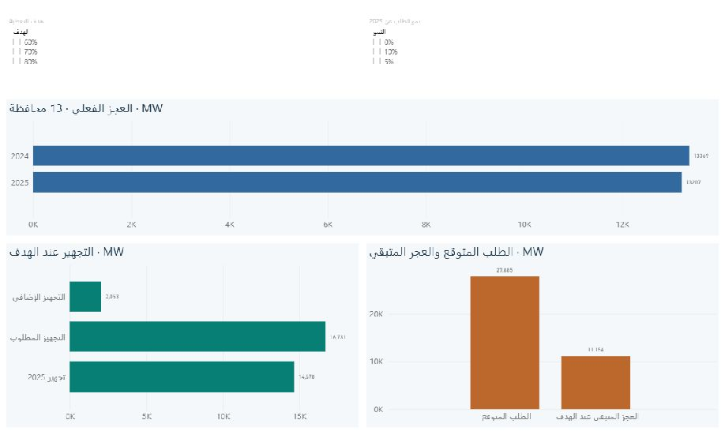
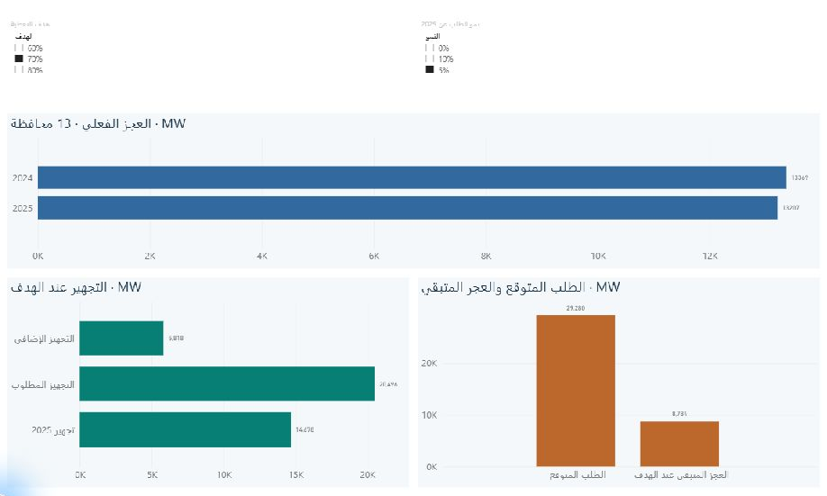
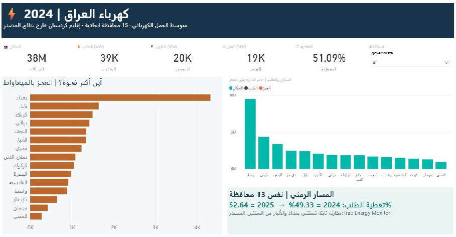
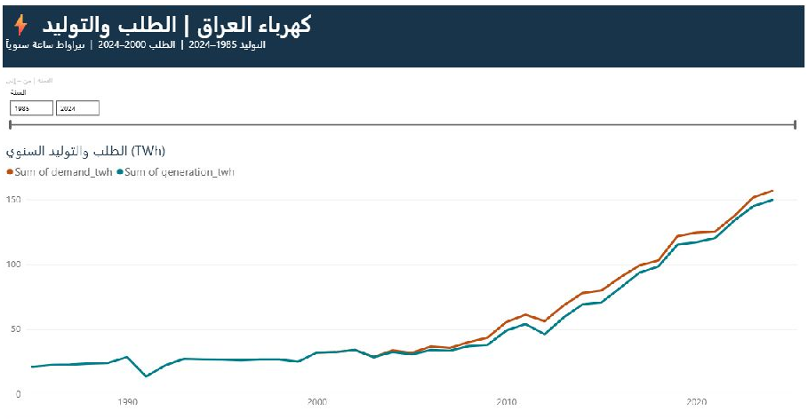

# Iraq Electricity Gap | 2024–2025

An Arabic Power BI report and reproducible SQL analysis of electricity demand, supplied power, and the gap between them. The scenario page lets you change the coverage target and demand growth to see the additional supply needed above the 2025 baseline.

## What changed across the same 13 governorates?

| Metric | 2024 | 2025 | Change |
| --- | ---: | ---: | ---: |
| Required load | 26,385 MW | 27,885 MW | +1,500 MW |
| Supplied load | 13,016 MW | 14,678 MW | +1,662 MW |
| Unmet load | 13,369 MW | 13,207 MW | −162 MW |
| Demand coverage | 49.33% | 52.64% | +3.31 percentage points |

Demand grew by almost as much as supply, so the gap fell only 162 MW. At a 70% coverage target and 5% demand growth, the model calls for 20,496 MW of supply, or **5,818 MW above the 2025 baseline**.

## Other report pages

## Open and reproduce

1. Download or clone the entire repository. Keep the Power BI project file next to its report and semantic model folders.
2. Open [the PBIP project](powerbi/Iraq%20Electricity%20-%20Diagnostics%20Charts.pbip) in Power BI Desktop. On first open, choose **Refresh now** if Power BI shows an incomplete-data banner. Then, on the diagnostics page, select one coverage target (60%, 70%, or 80%) and one demand growth assumption (0%, 5%, or 10%). The two scenario charts recalculate. The historical chart shows the observed gap.
3. Run `python build.py` from the repository root to rebuild the SQLite database and CSV outputs using the standard Python library. Check [the SQL views](analysis.sql) and [the scenario output](outputs/grid_target.csv).
4. Open [the 2024 Excel workbook](outputs/excel/Iraq%20Electricity%202024.xlsx) for the governorate-level analysis. The Power BI project includes a snapshot of the source values.

## Sources and methodology

- **Federal comparison.** [Iraq Energy Monitor’s 2025 summary](https://iraqem.com/electricity/) provides the aggregate for 13 governorates. The 2024 comparison sums the same 13 areas from the [governorate map](https://iraqem.com/governorates/). Baghdad and Anbar appear in the separate 2024 governorate analysis. The map uses varying demand labels. The original ministry tables have not been independently reconciled for every governorate. [Iraq Energy Monitor methodology](https://iraqem.com/data/)
- **Population.** The 2024 governorate analysis uses the official population estimates in table 22, printed page 36. The SQL joins by governorate and year after combining Baghdad municipality and outskirts. [Iraq Statistics and GIS Authority report](https://mail.cosit.gov.iq/documents/environment/stat/Full%20Report/%D9%83%D9%85%D9%8A%D8%A9%20%D9%88%D9%86%D9%88%D8%B9%D9%8A%D8%A9%20%D8%A7%D9%84%D9%85%D9%8A%D8%A7%D9%87%202024.pdf)
- **National series.** A separate page displays Iraq’s annual generation (1985–2024) and demand (2000–2024), measured in TWh. The federal comparison tracks load in MW. [Our World in Data Energy dataset](https://github.com/owid/energy-data)
- **Calculations.** Coverage is total supply divided by total demand. Unmet load is demand minus supply. Each scenario scales baseline demand by the selected growth rate, applies the coverage target and rounds required supply up to a whole MW before subtracting observed 2025 supply. Growth assumptions are illustrative. Outage duration is outside the data scope.
